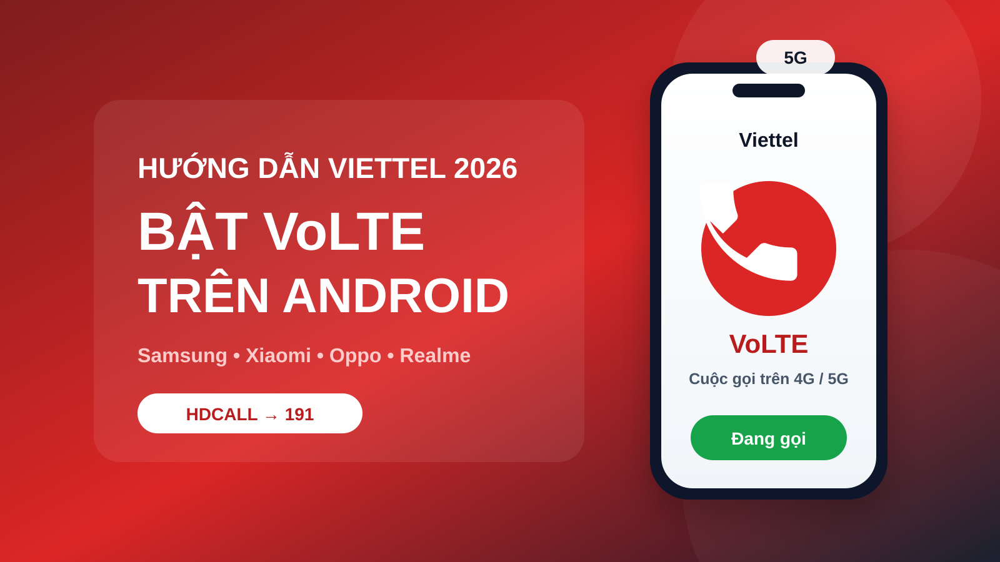

# Cách bật VoLTE Viettel trên Android: Samsung, Xiaomi, Oppo, Realme 2026

Nếu điện thoại Android dùng SIM/eSIM Viettel nhưng khi gọi máy rơi khỏi 4G/5G, không thấy mục **VoLTE / Cuộc gọi VoLTE** hoặc data bị gián đoạn trong lúc gọi, hãy kiểm tra theo thứ tự: **máy hỗ trợ → SIM/thuê bao → dịch vụ VoLTE → cài đặt mạng → cuộc gọi thử**.

Theo hướng dẫn chính thức của Viettel, thuê bao có thể đăng ký dịch vụ VoLTE/HD Voice bằng cú pháp **`HDCALL` gửi `191`**, phí dịch vụ được Viettel công bố là **0 đồng**. Viettel cũng lưu ý nhiều thuê bao có thể đã được đăng ký sẵn.

## VoLTE Viettel trên Android là gì?

VoLTE (Voice over LTE) là cuộc gọi thoại được thiết lập trên hạ tầng 4G/LTE thay vì phải rơi về lớp mạng thoại cũ. Viettel cho biết VoLTE giúp rút ngắn thời gian thiết lập cuộc gọi và cho phép duy trì kết nối data 4G/5G trong khi đàm thoại khi thiết bị, thuê bao và vùng mạng đáp ứng.

Trên Android, tên công tắc không giống nhau trên mọi hãng. Bạn có thể thấy **VoLTE**, **Cuộc gọi VoLTE**, **4G Calling**, **HD Voice** hoặc chỉ thấy lựa chọn mạng 4G/5G mà không có một công tắc riêng. Viettel cũng lưu ý giao diện thực tế có thể khác theo dòng máy và phiên bản phần mềm.

## Điều kiện trước khi bật VoLTE Viettel

Theo tài liệu Viettel, cần kiểm tra các điều kiện cơ bản sau:

1. Thuê bao đang dùng **SIM 4G/5G hoặc eSIM Viettel** phù hợp.
2. Điện thoại Android có hỗ trợ VoLTE.
3. Dịch vụ VoLTE đã được đăng ký trên thuê bao hoặc được Viettel kích hoạt sẵn.
4. SIM Viettel được chọn đúng trong phần mạng di động nếu máy dùng hai SIM.
5. Chế độ mạng được đặt ở 4G/LTE hoặc 5G phù hợp với thiết bị.

Không nên kết luận lỗi nằm ở SIM chỉ vì máy không hiện một biểu tượng VoLTE. Trước hết cần kiểm tra trạng thái dịch vụ và cấu hình của đúng SIM Viettel.

## Bước 1: đăng ký VoLTE Viettel bằng HDCALL gửi 191

Mở ứng dụng Tin nhắn và soạn:

**`HDCALL` gửi `191`**

Viettel công bố phí đăng ký dịch vụ VoLTE là **0 đồng**. Đây là cú pháp đăng ký dịch vụ thoại VoLTE/HD Voice, **không phải cú pháp mua gói data** và không thay đổi luồng đăng ký gói cước trên website này.

Nếu thuê bao đã có VoLTE, không cần đăng ký lặp lại chỉ để thử lỗi giao diện.

## Bước 2: bật VoLTE trên Android theo hướng dẫn chung của Viettel

Viettel hướng dẫn đường dẫn chung trên Android như sau:

**Cài đặt (Settings) → Mạng di động (Mobile networks) → chọn SIM Viettel nếu có nhiều SIM → chọn mạng 4G hoặc 5G → bật VoLTE / Cuộc gọi VoLTE nếu máy có công tắc này.**

Tên menu có thể khác trên Samsung, Xiaomi/Redmi/Poco, Oppo/Realme, Vivo, Google Pixel, Sony Xperia, Huawei hoặc các phiên bản Android khác. Vì vậy, hãy tìm các từ khóa **Mạng di động**, **SIM**, **Loại mạng ưu tiên**, **VoLTE** hoặc **Cuộc gọi 4G** thay vì cố tìm đúng một đường dẫn giống hệt trên mọi máy.

## Samsung: kiểm tra VoLTE Viettel ở đâu?

Trên nhiều máy Samsung, phần mạng di động thường nằm dưới nhánh **Cài đặt → Kết nối → Các mạng di động**. Tùy phiên bản One UI và model, máy có thể hiển thị mục **Cuộc gọi VoLTE** hoặc tự quản lý VoLTE khi SIM và cấu hình nhà mạng đã đáp ứng.

Nếu dùng hai SIM, hãy chắc chắn đang kiểm tra đúng SIM Viettel. Sau khi chỉnh, thực hiện một cuộc gọi thử và quan sát trạng thái 4G/5G/LTE trong lúc gọi.

Không nên dùng đường dẫn của một model Samsung cụ thể để khẳng định tất cả máy Samsung đều giống nhau; Viettel cũng nêu rõ giao diện có thể khác theo dòng máy và phiên bản.

## Xiaomi, Redmi và Poco: không thấy nút VoLTE thì làm gì?

Với nhóm Xiaomi/Redmi/Poco, tên menu và cách hiển thị VoLTE có thể thay đổi theo MIUI/HyperOS, model và cấu hình nhà mạng. Hãy ưu tiên kiểm tra:

- đúng SIM Viettel đang hoạt động;
- loại mạng ưu tiên có 4G/LTE hoặc 5G;
- thuê bao đã có dịch vụ VoLTE;
- máy đã cập nhật phần mềm ổn định;
- thực hiện cuộc gọi thử sau khi cấu hình.

Không nên nhập các mã kỹ thuật không được Viettel hướng dẫn chính thức chỉ để ép hiện công tắc VoLTE. Nếu máy hỗ trợ nhưng không có tùy chọn phù hợp, nên xác minh trạng thái thuê bao với Viettel trước khi thay đổi cài đặt sâu.

## Oppo và Realme: cách kiểm tra nhanh

Viettel liệt kê Oppo & Realme trong nhóm thiết bị có hướng dẫn bật VoLTE. Trên thực tế, tên mục có thể nằm trong **SIM & mạng di động**, **Mạng di động** hoặc một nhánh tương đương tùy ColorOS/realme UI.

Cách kiểm tra an toàn là:

1. chọn đúng SIM Viettel;
2. chọn 4G/LTE hoặc 5G làm loại mạng phù hợp;
3. bật **VoLTE/Cuộc gọi VoLTE** nếu tùy chọn xuất hiện;
4. gọi thử;
5. nếu chưa được, khởi động lại máy rồi kiểm tra lại như Viettel khuyến nghị.

## Cách biết VoLTE Viettel đã hoạt động

Viettel hướng dẫn người dùng thực hiện một **cuộc gọi đi** để kiểm tra. Tùy thiết bị, trong lúc gọi máy có thể tiếp tục hiển thị **4G, 5G, LTE hoặc VoLTE** cạnh cột sóng.

Không nên chỉ dựa vào một biểu tượng. Một số giao diện Android không hiển thị chữ VoLTE dù dịch vụ đã được cấu hình. Dấu hiệu cần quan sát là cuộc gọi được thiết lập bình thường và kết nối dữ liệu 4G/5G/LTE vẫn được duy trì theo khả năng của thiết bị và mạng.

## Tại sao Android đã bật 4G/5G nhưng gọi vẫn không chạy VoLTE?

### 1. Thuê bao chưa có dịch vụ VoLTE

Kiểm tra bước **`HDCALL` gửi `191`** hoặc liên hệ Viettel để xác minh trạng thái dịch vụ. Việc máy có 4G/5G không tự động chứng minh VoLTE trên thuê bao đã sẵn sàng.

### 2. Đang chỉnh nhầm SIM trên máy hai SIM

Máy Android hai SIM có thể dùng SIM này cho data nhưng SIM khác cho thoại. Hãy kiểm tra đúng SIM Viettel trong phần quản lý SIM/mạng di động trước khi thay đổi VoLTE.

### 3. Thiết bị hoặc firmware không hỗ trợ VoLTE phù hợp

Viettel lưu ý một số thiết bị cũ không tương thích VoLTE. Nếu thuê bao đã có dịch vụ nhưng máy không có tùy chọn và cuộc gọi vẫn rơi khỏi 4G/LTE, cần kiểm tra khả năng hỗ trợ của chính model và phiên bản phần mềm.

### 4. Chế độ mạng chưa đặt ở 4G/LTE hoặc 5G

Nếu máy đang bị khóa ở lớp mạng không phù hợp, hãy chuyển về lựa chọn 4G/LTE hoặc 5G mà thiết bị cung cấp rồi gọi thử lại.

### 5. Cần khởi động lại sau khi thay đổi cấu hình

Trong hướng dẫn Viettel, nếu chưa thành công sau khi bật dịch vụ/cài đặt, người dùng được khuyến nghị khởi động lại máy và kiểm tra lại bằng cuộc gọi đi.

## Có cần đổi SIM để dùng VoLTE Viettel trên Android không?

Không nên mặc định phải đổi SIM chỉ vì chưa thấy VoLTE. Tài liệu Viettel yêu cầu SIM 4G/5G và thiết bị hỗ trợ VoLTE; vì vậy, nếu SIM/eSIM hiện tại đã đáp ứng nhưng dịch vụ chưa hoạt động, hãy kiểm tra thuê bao và cấu hình trước.

Nếu bạn đang dùng eSIM và vấn đề là kích hoạt 5G chứ không phải thoại VoLTE, xem hướng dẫn [kích hoạt eSIM 5G Viettel](/posts/esim-5g-kich-hoat-quet-qr/).

## VoLTE Android và VoLTE khi roaming có giống nhau không?

Không hoàn toàn. Bài này xử lý **VoLTE trong nước trên điện thoại Android**. Khi ở nước ngoài, ngoài thiết bị và thuê bao còn có điều kiện chuyển vùng quốc tế, mạng đối tác và vùng hỗ trợ VoLTE Roaming.

Nếu lỗi xảy ra khi đang ở nước ngoài, xem hướng dẫn riêng [cách bật VoLTE khi roaming Viettel](/posts/bat-volte-khi-roaming-viettel/).

## Nếu dùng iPhone thì xem ở đâu?

Đường dẫn iOS khác Android. Xem canonical riêng [cách bật VoLTE Viettel trên iPhone](/posts/cai-dat-4g-5g-volte-iphone-viettel/) để tránh áp dụng nhầm menu Android cho iPhone.

## Không nên làm gì khi VoLTE chưa hoạt động

- Không xóa eSIM chỉ để thử sửa lỗi VoLTE.
- Không reset toàn bộ cài đặt mạng ngay từ bước đầu.
- Không thay APN nếu data vẫn bình thường và lỗi chỉ nằm ở thoại VoLTE.
- Không dùng mã kỹ thuật không có trong hướng dẫn Viettel để ép bật tính năng.
- Không nhầm VoLTE trong nước với Data Roaming hoặc VoLTE Roaming.

## Khi nào cần liên hệ Viettel?

Nếu đã kiểm tra đủ **thiết bị hỗ trợ, SIM 4G/5G, dịch vụ VoLTE, đúng SIM, mạng 4G/5G và đã khởi động lại** nhưng cuộc gọi vẫn không hoạt động như mong đợi, nên liên hệ Viettel để kiểm tra trạng thái thuê bao. Tài liệu VoLTE của Viettel công bố tổng đài hỗ trợ miễn phí **1800 8098**.

## Câu hỏi nhanh

### Bật VoLTE Viettel trên Android có mất phí không?
Theo tài liệu Viettel, phí đăng ký dịch vụ VoLTE bằng `HDCALL` gửi `191` là **0 đồng**.

### Samsung không có nút VoLTE có phải SIM bị lỗi không?
Chưa thể kết luận. Cách hiển thị phụ thuộc model, phần mềm và cấu hình; hãy kiểm tra trạng thái dịch vụ, đúng SIM Viettel và thực hiện cuộc gọi thử trước.

### Xiaomi/Redmi/Poco có dùng chung cú pháp HDCALL gửi 191 không?
`HDCALL` gửi `191` là cú pháp Viettel công bố để đăng ký dịch vụ VoLTE trên thuê bao; phần menu thiết bị mới thay đổi theo hãng/model.

### Android đang hiện 5G có nghĩa VoLTE đã bật chưa?
Không. 5G là trạng thái lớp mạng dữ liệu; VoLTE cần được kiểm tra bằng trạng thái dịch vụ, cấu hình và cuộc gọi thử.

## Nguồn chính thức

- [Viettel: Hướng dẫn bật dịch vụ cuộc gọi VoLTE trên iPhone, Samsung, Huawei, Oppo & Realme, Redmi/Xiaomi, Nokia, Vivo, Poco, Pixel, Sony Xperia, Masstel](https://098.viettel.vn/tin-tuc/huong-dan-bat-dich-vu-cuoc-goi-volte-goi-chat-luong-tot-hon-an-toan-hon/15298552) — ngày 14/04/2026.
- [Viettel: VoLTE – dịch vụ thoại chất lượng cao trên hạ tầng mạng 4G/5G](https://098.viettel.vn/tin-tuc/chi-tiet/volte-dich-vu-thoai-chat-luong-cao-tren-ha-tang-mang-4g5g-viettel/13748208) — hướng dẫn Android, cú pháp `HDCALL` gửi `191`, phí 0 đồng và cách kiểm tra.

Thông tin menu có thể thay đổi theo model Android và phiên bản phần mềm. Khi giao diện trên máy khác hướng dẫn, ưu tiên tài liệu live của Viettel và hỗ trợ chính thức của hãng thiết bị.
