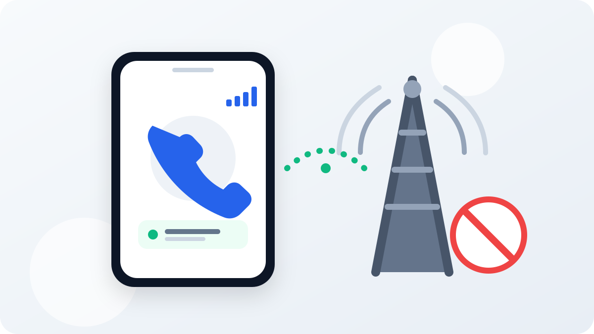

# Điện thoại bàn phím 4G Viettel sau tắt 2G: kiểm tra VoLTE thế nào?

**Cập nhật 12/09/2026:** chỉ còn **3 ngày** tới mốc 15/09/2026. Nếu đang dùng điện thoại bàn phím có 4G với SIM Viettel, đừng chỉ nhìn biểu tượng 4G rồi kết luận máy chắc chắn gọi được sau khi 2G dừng. Điều cần kiểm tra là **máy có hỗ trợ VoLTE, SIM/thuê bao dùng được 4G/5G và cuộc gọi thực tế có chạy ổn định hay không**.

> **Trả lời nhanh:** Viettel có hướng dẫn VoLTE cho cả **máy bàn phím 4G**. Tuy nhiên, không phải mọi điện thoại bàn phím ghi “4G” đều mặc định hỗ trợ VoLTE hoặc USSD qua 4G/IMS. Hãy kiểm tra đúng model, bật VoLTE nếu máy có tùy chọn, dùng SIM 4G/5G, đăng ký/kiểm tra VoLTE và gọi thử trước ngày 15/09/2026.

## Vì sao máy bàn phím 4G vẫn cần kiểm tra VoLTE?

4G cho dữ liệu và VoLTE cho thoại là hai khả năng liên quan nhưng không hoàn toàn giống nhau.

Một máy có thể truy cập Internet bằng 4G nhưng phần thoại vẫn phụ thuộc vào lớp mạng cũ nếu thiết bị, phần mềm, SIM hoặc trạng thái dịch vụ chưa đáp ứng VoLTE. Khi hạ tầng 2G dừng theo lộ trình, trường hợp này có thể dẫn tới việc **vẫn có dữ liệu nhưng gọi điện không ổn định hoặc không thiết lập được cuộc gọi**.

Theo hướng dẫn VoLTE của Viettel, điều kiện cơ bản gồm:

1. dùng **SIM 4G/5G**;
2. điện thoại **4G/5G có hỗ trợ VoLTE**;
3. bật VoLTE/Cuộc gọi 4G trên thiết bị khi model có tùy chọn;
4. đăng ký hoặc xác minh dịch vụ VoLTE trên thuê bao;
5. thực hiện cuộc gọi thử để kiểm tra thực tế.

Nguồn Viettel:
- [Viettel — Hướng dẫn bật dịch vụ cuộc gọi VoLTE trên nhiều dòng máy, 14/04/2026](https://098.viettel.vn/tin-tuc/huong-dan-bat-dich-vu-cuoc-goi-volte-goi-chat-luong-tot-hon-an-toan-hon/15298552)
- [Viettel — VoLTE, dịch vụ thoại trên hạ tầng 4G/5G](https://098.viettel.vn/tin-tuc/chi-tiet/volte-dich-vu-thoai-chat-luong-cao-tren-ha-tang-mang-4g5g-viettel/13748208)

## Viettel có hỗ trợ VoLTE trên điện thoại bàn phím 4G không?

**Có hướng dẫn chính thức cho nhóm máy này.** Trong hướng dẫn VoLTE, Viettel liệt kê iPhone, nhiều hãng Android và cả **“các dòng máy bàn phím 4G khác”**.

Ở hướng dẫn tổng quát, Viettel mô tả đường dẫn trên feature phone 4G/5G theo dạng:

**Cài đặt → Kết nối → chọn SIM → chọn mạng 4G/5G → bật VoLTE/Cuộc gọi VoLTE**

Tên menu thực tế có thể khác theo hãng, model và phiên bản phần mềm. Vì vậy, nếu máy không có đúng chữ giống hướng dẫn, không nên tự nhập mã kỹ thuật hoặc sửa cấu hình ẩn. Hãy tra đúng model hoặc liên hệ Viettel để kiểm tra khả năng tương thích.

## Cách kiểm tra máy bàn phím 4G Viettel trước 15/9/2026

### 1. Xác nhận máy thực sự hỗ trợ VoLTE

Không dùng chữ “4G” trên vỏ máy làm bằng chứng duy nhất. Hãy kiểm tra thông số của đúng model hoặc hướng dẫn từ nhà sản xuất/Viettel xem máy có **VoLTE / 4G Calling / HD Voice** hay không.

Nếu thiết bị chỉ có 4G data nhưng không có VoLTE, việc có biểu tượng 4G chưa đủ để bảo đảm thoại sau khi 2G dừng.

### 2. Kiểm tra SIM Viettel đang dùng là SIM 4G/5G

Viettel nêu SIM 4G/5G là một trong các điều kiện dùng VoLTE. Nếu bạn không chắc SIM quá cũ đang dùng có đáp ứng hay không, hãy kiểm tra qua kênh chính thức thay vì tự mặc định rằng phải đổi SIM.

Bài riêng về câu hỏi này: [SIM 4G Viettel có dùng được 5G không?](/posts/sim-4g-viettel-co-dung-duoc-5g-khong/).

### 3. Bật VoLTE/Cuộc gọi 4G nếu máy có tùy chọn

Trên máy bàn phím 4G, menu thường nằm trong phần **Kết nối**, **Mạng di động**, **SIM** hoặc **Cài đặt cuộc gọi**. Tên chính xác phụ thuộc thiết bị.

Nếu máy có hai SIM, hãy kiểm tra đúng khe SIM Viettel đang dùng cho thoại.

### 4. Kiểm tra dịch vụ VoLTE trên thuê bao

Theo Viettel, có thể đăng ký VoLTE bằng:

**`HDCALL` gửi `191`**

Viettel công bố **phí dịch vụ VoLTE là 0 đồng**. Đây là phí dịch vụ VoLTE, không phải tuyên bố rằng mọi cuộc gọi đều miễn phí; cước thoại vẫn phụ thuộc gói cước và chính sách thuê bao.

Nhiều thuê bao có thể đã được kích hoạt VoLTE sẵn, nên bước quan trọng tiếp theo vẫn là **gọi thử thực tế**.

### 5. Gọi thử và quan sát trạng thái mạng

Thực hiện một cuộc gọi đi. Tùy máy, biểu tượng có thể tiếp tục hiện 4G/LTE/VoLTE trong lúc gọi.

Nếu cuộc gọi không thiết lập được, rớt mạng, hoặc máy chuyển về lớp mạng cũ, hãy kiểm tra lại thiết bị, phần mềm, SIM và trạng thái VoLTE với Viettel trước mốc 15/09.

## Máy bàn phím 4G gọi được nhưng *101#, *102#, *098# không chạy thì sao?

Đây là một vấn đề **khác với VoLTE**.

Viettel đã cảnh báo một số thiết bị cần cập nhật phần mềm hoặc hỗ trợ **USSD over IMS** để các mã USSD tiếp tục hoạt động khi lớp mạng cũ được dừng. Vì vậy có thể xảy ra tình huống:

- gọi thoại VoLTE vẫn hoạt động;
- nhưng một số mã bấm USSD không hoạt động nếu thiết bị/phần mềm chưa hỗ trợ USSD qua 4G/IMS.

Nếu bạn thường dùng `*101#`, `*102#`, `*098#`, `*100*mã thẻ#` hoặc các mã tương tự, xem hướng dẫn riêng tại [USSD Viettel qua 4G/VoLTE/IMS](/posts/ussd-viettel-qua-4g-volte-ims/).

Nguồn Viettel:
- [Viettel — Cập nhật phần mềm và thiết bị hỗ trợ USSD khi tắt 2G, 03/07/2026](https://098.viettel.vn/tin-tuc/chi-tiet/cap-nhat-phan-mem-va-thiet-bi-ho-tro-ussd-khong-lo-gian-doan-dich-vu-khi-tat-song-2g/14894320)

## Có phải mọi máy bàn phím 4G đều dùng được sau khi tắt 2G?

**Không nên kết luận như vậy.** “Máy 4G” là mô tả chưa đủ để xác nhận khả năng thoại VoLTE và USSD over IMS.

Cần tách ba câu hỏi:

1. máy có kết nối dữ liệu 4G không;
2. máy có VoLTE để gọi thoại trên 4G không;
3. phần mềm máy có hỗ trợ các dịch vụ phụ như USSD over IMS hay không.

Chỉ khi kiểm tra đúng model và gọi thử thành công mới có cơ sở thực tế tốt hơn để kết luận thiết bị đang sẵn sàng.

## Mốc 15/9/2026 có thay đổi không?

Nguồn Bộ Khoa học và Công nghệ ngày **09/09/2026** tiếp tục nêu hệ thống GSM được sử dụng đến hết **15/09/2026**. Băng tần 900 MHz từng phục vụ 2G đang được quy hoạch lại cho 4G/5G.

Bài này không suy diễn rằng toàn bộ người dùng sẽ có tốc độ 4G/5G tăng ngay sau ngày 15/09, cũng không khẳng định mọi khu vực có cùng trạng thái triển khai.

Nguồn quản lý nhà nước:
- [Bộ Khoa học và Công nghệ — kết quả đấu giá băng tần 900 MHz và lộ trình GSM, 09/09/2026](https://mst.gov.vn/vnpt-viettel-vietnamobile-cung-trung-dau-gia-3-cap-khoi-bang-tan-900mhz-197260909205107936.htm)

Viettel Store ngày 07/09 cũng khuyến nghị người dùng chủ động kiểm tra thiết bị và khả năng VoLTE trong giai đoạn cuối của lộ trình tắt 2G:
- [Viettel Store — Cắt sóng 2G, chủ động kiểm tra thiết bị và VoLTE, 07/09/2026](https://viettelstore.vn/tin-tuc/cat-song-2g-len-doi-galaxy-a-series)

## Checklist nhanh cho người đang dùng điện thoại bàn phím

Trước 15/09/2026, hãy hoàn thành đủ các bước sau:

- xác nhận đúng model có VoLTE;
- cập nhật phần mềm nếu nhà sản xuất/Viettel có hướng dẫn;
- dùng SIM 4G/5G;
- bật VoLTE/Cuộc gọi 4G nếu máy có tùy chọn;
- kiểm tra hoặc đăng ký VoLTE bằng kênh chính thức;
- gọi thử thực tế;
- thử các mã USSD bạn còn sử dụng;
- nếu USSD lỗi, chuyển sang My Viettel/Tammi, SMS hoặc kênh hỗ trợ phù hợp;
- nếu thoại vẫn lỗi, liên hệ Viettel với đúng model máy và số thuê bao để được kiểm tra.

Nếu bạn dùng smartphone thay vì máy bàn phím, xem hướng dẫn theo nền tảng:
- [Bật VoLTE Viettel trên Android](/posts/bat-volte-viettel-android/)
- [Bật VoLTE Viettel trên iPhone](/posts/cai-dat-4g-5g-volte-iphone-viettel/)
- [Tắt sóng 2G 15/9/2026: điện thoại 4G Viettel cần kiểm tra gì?](/posts/tat-song-2g-15-9-2026-viettel-volte/)

## FAQ

### Điện thoại bàn phím 4G Viettel có cần đổi máy khi tắt 2G không?

Không thể kết luận chỉ từ chữ “4G”. Nếu đúng model hỗ trợ VoLTE, SIM/thuê bao đáp ứng và cuộc gọi thử hoạt động trên 4G thì chưa có cơ sở để mặc định phải đổi máy. Nếu model không hỗ trợ VoLTE, cần cân nhắc thiết bị tương thích.

### Máy có VoLTE nhưng không có công tắc VoLTE thì sao?

Menu phụ thuộc model và firmware. Một số máy có thể được cấu hình khác nhau. Không nên dùng mã kỹ thuật không có trong tài liệu chính thức; hãy kiểm tra hướng dẫn đúng model hoặc liên hệ Viettel.

### HDCALL gửi 191 có phải gói cước data không?

Không. Đây là cú pháp Viettel hướng dẫn cho dịch vụ VoLTE. Bài này không dùng cú pháp đó để thay đổi gói data hoặc luồng đăng ký gói cước của website.

### Máy gọi được nhưng USSD không chạy có nghĩa VoLTE lỗi không?

Không nhất thiết. VoLTE và USSD over IMS là hai khả năng khác nhau. Hãy kiểm tra USSD riêng theo hướng dẫn của Viettel.
