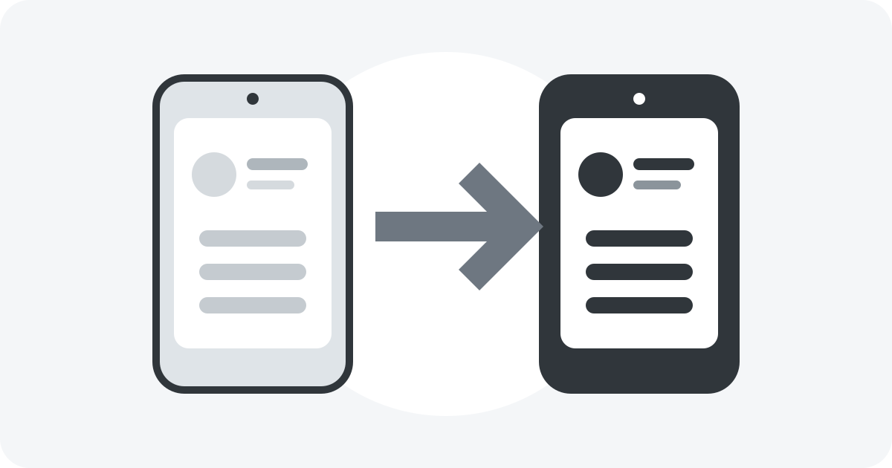

# My Viettel từ 1/10/2026: chuyển sang Viettel Tammi thế nào?

> **Trả lời nhanh:** Viettel Telecom thông báo **ngày 01/10/2026, My Viettel sẽ “chính thức hoàn thành sứ mệnh”** và các dịch vụ quen thuộc của My Viettel đã được nâng cấp, tích hợp vào **Viettel Tammi**. Nếu đang quen kiểm tra thuê bao, Internet hoặc truyền hình trong My Viettel, bạn nên làm quen với khu vực **My Viettel trong Tammi** trước mốc này.

## Viettel đã công bố điều gì về My Viettel?

Trong thông báo ngày **17/09/2026**, Viettel cho biết các dịch vụ quen thuộc của My Viettel đã được tích hợp vào siêu ứng dụng Viettel Tammi và nêu mốc **01/10/2026** cho việc My Viettel “hoàn thành sứ mệnh”.

Cách diễn đạt này quan trọng: bài viết này **không tự suy diễn** rằng mọi phiên bản My Viettel sẽ lập tức biến mất khỏi mọi thiết bị đúng 0 giờ ngày 01/10. Phần có thể xác nhận từ nguồn first-party là Viettel đang chuyển trải nghiệm quản lý dịch vụ sang Tammi và công bố mốc chuyển tiếp nói trên.

## Sang Tammi, bạn có thể quản lý những gì?

Theo Viettel, Tammi cho phép quản lý toàn bộ hệ sinh thái Viettel trên một tài khoản, trong đó có:

- các số điện thoại di động chính chủ;
- đường truyền Internet cố định;
- dịch vụ truyền hình;
- các chức năng viễn thông quen thuộc được tích hợp trong khu vực My Viettel của Tammi.

Viettel cũng đang dùng chính khu vực **My Viettel trên Tammi** cho các luồng dịch vụ mới. Ví dụ, chương trình eSIM tháng 9/2026 hướng dẫn người dùng vào tab My Viettel trên Tammi để chọn **Mua SIM - eSIM**.

## Trước 01/10/2026 nên làm gì?

Nếu bạn vẫn đang dùng My Viettel hằng ngày, có thể chuẩn bị theo thứ tự đơn giản sau:

1. cài hoặc cập nhật **Viettel Tammi** từ kho ứng dụng chính thức;
2. đăng nhập bằng số điện thoại đang quản lý dịch vụ Viettel;
3. mở khu vực **My Viettel** trong Tammi;
4. kiểm tra các thuê bao/dịch vụ chính chủ đang hiển thị;
5. nếu đang cần thao tác quan trọng như đổi eSIM, xác thực thuê bao hoặc quản lý dịch vụ, đọc kỹ thông tin hệ thống hiển thị trước khi xác nhận.

Không nên tải file APK Tammi từ nguồn không rõ ràng hoặc cung cấp OTP cho người tự xưng hỗ trợ qua đường dẫn lạ.

## My Viettel và Viettel Tammi có phải hai tài khoản riêng không?

Thông báo của Viettel mô tả Tammi theo hướng **quản lý toàn diện chỉ với một tài khoản** và đồng bộ các số điện thoại chính chủ, Internet cố định và truyền hình. Vì vậy, search job quan trọng ở đây là **chuyển nơi quản lý dịch vụ**, không phải tạo một thuê bao Viettel mới.

Nếu tài khoản của bạn không hiển thị đúng dịch vụ hoặc số điện thoại, không nên tự kết luận dữ liệu đã mất. Hãy kiểm tra trạng thái chính chủ và kênh hỗ trợ chính thức trước. Bạn có thể xem thêm hướng dẫn [kiểm tra SIM Viettel chính chủ](/posts/kiem-tra-sim-viettel-chinh-chu/).

## Các thao tác cũ như *101# có bị ảnh hưởng không?

Đây là một vấn đề khác với việc My Viettel chuyển sang Tammi. Sau lộ trình tắt 2G, một số thiết bị/phần mềm không hỗ trợ **USSD over IMS** có thể gặp vấn đề với các mã USSD. Viettel đã có hướng dẫn riêng về việc cập nhật thiết bị/phần mềm và dùng kênh thay thế.

Nếu bạn đang gặp lỗi với *101#, *102# hoặc mã USSD khác, xem bài [USSD Viettel sau tắt 2G: cách kiểm tra 4G/IMS và phương án thay thế](/posts/ussd-viettel-qua-4g-volte-ims/). Không nên gộp lỗi USSD với việc chuyển ứng dụng My Viettel → Tammi thành cùng một nguyên nhân.

## Đổi eSIM trên Tammi có liên quan gì đến thay đổi này?

Có ở góc độ kênh phục vụ: Viettel đang đưa nhiều luồng quản lý thuê bao sang Tammi. Tuy nhiên, **phí eSIM, ưu đãi hòa mạng và điều kiện áp dụng là một search job riêng** và có thể thay đổi theo chương trình.

Nếu mục tiêu của bạn là kiểm tra chi phí/ưu đãi eSIM hiện hành, xem [phí eSIM Viettel 2026](/posts/phi-esim-viettel-2026/) thay vì suy từ việc My Viettel chuyển sang Tammi.

## Câu hỏi thường gặp

### My Viettel có dừng từ 01/10/2026 không?

Viettel dùng câu **“My Viettel sẽ chính thức hoàn thành sứ mệnh” vào ngày 01/10/2026** và cho biết các dịch vụ quen thuộc đã được tích hợp vào Viettel Tammi. Bài này giữ đúng cách diễn đạt first-party đó, không mở rộng thành khẳng định kỹ thuật chưa được Viettel công bố.

### Viettel Tammi có thay My Viettel không?

Theo thông báo Viettel, Tammi là nơi các dịch vụ quen thuộc của My Viettel được nâng cấp và tích hợp, đồng thời cho phép quản lý các dịch vụ Viettel trong một tài khoản.

### Có cần đổi SIM khi chuyển từ My Viettel sang Tammi không?

Không có cơ sở trong thông báo ngày 17/09 để nói rằng việc chuyển ứng dụng quản lý bắt buộc người dùng phải đổi SIM. Đổi SIM/eSIM là quy trình riêng, chỉ thực hiện khi nhu cầu hoặc điều kiện thuê bao của bạn yêu cầu.

### Tammi quản lý được Internet Viettel không?

Viettel nêu Tammi có thể đồng bộ **đường truyền Internet cố định** cùng số di động chính chủ và dịch vụ truyền hình trên một tài khoản.

### Có thể mua eSIM trong Tammi không?

Có luồng first-party đã được Viettel công bố: trong chương trình eSIM tháng 9/2026, người dùng được hướng dẫn vào **My Viettel → Mua SIM - eSIM** trên Tammi. Giá, ưu đãi và điều kiện cụ thể cần kiểm tra theo chương trình đang hiệu lực.

## Nguồn kiểm chứng

- [Viettel Telecom — Tạm biệt My Viettel - bắt đầu hành trình mới cùng Viettel Tammi](https://www.vietteltelecom.vn/index.php/tin-tuc/chi-tiet/tam-biet-my-viettel-bat-dau-hanh-trinh-moi-cung-viettel-tammi/12026648), công bố **17/09/2026**.
- [Viettel Telecom — Khuyến mãi hoàn 100% phí đăng ký eSIM khi hòa mạng mới trên App Viettel Tammi](https://www.vietteltelecom.vn/index.php/tin-tuc/chi-tiet/khuyen-mai-hoan-100-phi-dang-ky-esim-khi-hoa-mang-moi-tren-app-viettel-tammi/12804412), công bố **18/09/2026**.
- [Viettel — Cập nhật phần mềm và thiết bị hỗ trợ USSD: Không lo gián đoạn dịch vụ khi tắt sóng 2G](https://098.viettel.vn/tin-tuc/chi-tiet/cap-nhat-phan-mem-va-thiet-bi-ho-tro-ussd-khong-lo-gian-doan-dich-vu-khi-tat-song-2g/14894320), công bố **03/07/2026**.

**Phạm vi kiểm chứng:** mốc chuyển tiếp My Viettel → Tammi, phạm vi quản lý dịch vụ và các ví dụ luồng Tammi được lấy từ nguồn first-party Viettel. Search volume, KD, CPC, ranking và traffic potential không có dữ liệu xác minh trong lượt này và được giữ ở trạng thái `UNKNOWN`.
