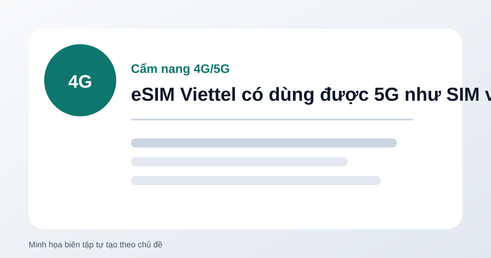

# Reset mạng iPhone có xóa eSIM Viettel, ảnh hưởng 5G không?

**Cập nhật kiểm chứng: 14/09/2026.** Trên iPhone, **Đặt lại cài đặt mạng (Reset Network Settings)** và **Xóa tất cả eSIM (Delete All eSIMs)** là hai thao tác khác nhau. Apple liệt kê chúng thành các lựa chọn reset riêng biệt, nên nếu mục tiêu của bạn chỉ là xử lý lỗi Wi‑Fi, dữ liệu di động, 4G/5G hoặc cấu hình mạng, không nên tự xóa eSIM Viettel như một bước thử lỗi.

> **Trả lời nhanh:** Reset Network Settings đưa các cài đặt mạng về mặc định và có thể làm một số tùy chọn như Data Roaming cần bật lại khi cần, nhưng Apple tách riêng thao tác **Delete All eSIMs** để xóa hồ sơ eSIM. Nếu chọn **Erase All Content and Settings**, iPhone có thể cho bạn chọn giữ hoặc xóa eSIM; nếu đã xóa eSIM, Apple hướng người dùng liên hệ nhà mạng để kích hoạt lại gói di động.

## Ba thao tác trên iPhone rất dễ bị nhầm

Khi vào phần đặt lại iPhone, người dùng thường nhìn thấy nhiều lựa chọn có tên gần giống nhau. Với thuê bao eSIM Viettel, cần phân biệt tối thiểu ba thao tác:

1. **Reset Network Settings / Đặt lại cài đặt mạng** — đặt lại cấu hình mạng về mặc định.
2. **Delete All eSIMs / Xóa tất cả eSIM** — xóa các hồ sơ eSIM khỏi thiết bị.
3. **Erase All Content and Settings / Xóa tất cả nội dung và cài đặt** — xóa dữ liệu trên iPhone và trong quá trình này có thể xuất hiện lựa chọn giữ hoặc xóa eSIM.

Apple mô tả các lựa chọn này riêng biệt trong tài liệu hỗ trợ iPhone. Vì vậy, không nên xem “reset mạng” và “xóa eSIM” là cùng một hành động.

Nguồn Apple:
- [Đặt lại các cài đặt iPhone về mặc định](https://support.apple.com/en-vn/guide/iphone/iphea1c2fe48/ios)
- [Cách đặt lại iPhone, iPad hoặc iPod touch về cài đặt gốc](https://support.apple.com/vi-vn/108931)
- [Cách xóa eSIM trên iPhone hoặc iPad](https://support.apple.com/vi-vn/102421)

## Reset Network Settings có xóa eSIM Viettel không?

Trong tài liệu đặt lại cài đặt, Apple mô tả **Reset Network Settings** là thao tác xóa/đưa các cài đặt mạng về mặc định và đặt **Delete All eSIMs** thành một lựa chọn riêng. Vì vậy, nếu bạn chỉ chọn đúng **Reset Network Settings**, không nên tự suy diễn rằng iPhone đang thực hiện lệnh xóa toàn bộ eSIM.

Điểm cần lưu ý là reset mạng có thể làm thay đổi những thiết lập bạn phải cấu hình lại sau đó, chẳng hạn:

- mạng Wi‑Fi và mật khẩu đã lưu;
- một số thiết lập mạng/VPN;
- lựa chọn mạng di động liên quan;
- **Data Roaming có thể cần bật lại** nếu bạn đang dùng roaming quốc tế.

Nếu bạn đang ở Việt Nam và dùng eSIM Viettel bình thường, sau reset hãy kiểm tra lại chính dòng eSIM Viettel, dữ liệu di động và 4G/5G thay vì xóa profile để “làm mới”.

## Khi nào eSIM thực sự bị xóa khỏi iPhone?

Apple có lựa chọn riêng **Delete All eSIMs**. Đây mới là thao tác được mô tả để xóa tất cả eSIM khỏi iPhone.

Apple cũng khuyến nghị **không xóa eSIM chỉ để xử lý sự cố** trừ khi nhà mạng hướng dẫn bạn làm vậy. Nếu eSIM đã bị xóa, người dùng có thể phải liên hệ nhà mạng để nhận/kích hoạt lại eSIM.

Với Viettel, điều đó có nghĩa là bạn không nên chọn “Xóa tất cả eSIM” chỉ vì:

- máy không hiện 5G;
- dữ liệu di động tạm thời không vào mạng;
- cuộc gọi/VoLTE chưa hoạt động như mong đợi;
- Wi‑Fi gặp lỗi;
- bạn vừa thay đổi một cài đặt mạng.

Những tình huống trên cần được chẩn đoán theo đúng nhánh lỗi trước, vì xóa eSIM có thể biến một lỗi cấu hình thành thêm một việc phải kích hoạt lại thuê bao trên thiết bị.

Nếu bạn **đã lỡ xóa eSIM Viettel**, xem owner riêng: [Lỡ xóa eSIM Viettel: có quét lại QR được không?](/posts/lo-xoa-esim-viettel-quet-lai-qr/).

## Xóa tất cả nội dung và cài đặt có làm mất eSIM Viettel không?

Khi dùng **Erase All Content and Settings**, Apple cho biết iPhone có thể hỏi bạn muốn **xóa eSIM hay giữ eSIM**.

Đây là điểm quan trọng nếu bạn reset máy nhưng vẫn muốn tiếp tục sử dụng cùng số Viettel trên chính chiếc iPhone đó. Hãy đọc kỹ màn hình xác nhận và không chọn xóa eSIM theo thói quen nếu mục tiêu của bạn chỉ là xóa dữ liệu máy.

Nếu chọn xóa eSIM trong quá trình factory reset, Apple nêu rằng bạn cần liên hệ nhà mạng để kích hoạt lại gói cước di động. Bài này không suy diễn rằng mọi eSIM Viettel đã xóa đều có thể tự khôi phục chỉ bằng một nút bấm.

Viettel đã công bố từ ngày 18/08/2026 một luồng kích hoạt eSIM trên iOS có thể không cần người dùng tự quét QR trong các trường hợp được hỗ trợ. Tuy nhiên, **“Viettel có luồng kích hoạt không cần QR” không đồng nghĩa “mọi profile eSIM đã xóa luôn tự phục hồi được”**. Trạng thái thuê bao, thiết bị và flow được cấp cho trường hợp cụ thể vẫn cần được xác minh.

Nguồn Viettel: [eSIM Viettel: Chạm là kết nối — kích hoạt không cần mã QR](https://www.vietteltelecom.vn/tin-tuc/chi-tiet/esim-viettel-cham-la-ket-noi-kich-hoat-khong-can-ma-qr/13707592).

## Nếu iPhone Viettel mất 4G/5G, có nên reset mạng ngay không?

Không nên bắt đầu bằng thao tác mạnh nhất. Hãy kiểm tra từ các bước ít rủi ro hơn:

1. **Bật/tắt Chế độ máy bay** rồi kiểm tra lại kết nối.
2. Xác nhận **dòng Viettel đang được bật** trong phần Di động/Mạng di động.
3. Xác nhận Viettel là dòng được chọn cho **Dữ liệu di động** nếu máy có nhiều SIM/eSIM.
4. Kiểm tra chế độ mạng/5G theo khả năng của model và cấu hình hiện tại.
5. Khởi động lại iPhone nếu lỗi xuất hiện sau cập nhật hoặc thay đổi cài đặt.
6. Chỉ dùng **Reset Network Settings** khi các bước đơn giản không giải quyết được hoặc hướng dẫn hỗ trợ yêu cầu.
7. Sau reset, kiểm tra lại dữ liệu di động, 4G/5G, Wi‑Fi và Data Roaming nếu bạn đang ở nước ngoài.

Nếu iPhone nhận SIM/eSIM nhưng báo lỗi không đăng ký được 5G, xem [lỗi không đăng ký được mạng 5G Viettel](/posts/loi-khong-dang-ky-duoc-mang-5g-viettel/) thay vì xóa eSIM ngay.

Nếu vấn đề nằm ở cuộc gọi/VoLTE, xem [cài đặt 4G/5G và VoLTE Viettel trên iPhone](/posts/cai-dat-4g-5g-volte-iphone-viettel/).

## Sau khi reset mạng, nên kiểm tra gì trên eSIM Viettel?

Sau khi iPhone khởi động lại, hãy kiểm tra theo thứ tự để tránh thay đổi nhiều thứ cùng lúc:

- dòng eSIM Viettel còn xuất hiện trong **Cài đặt → Di động/Mạng di động**;
- dòng Viettel đang được bật;
- Viettel được chọn cho dữ liệu di động nếu máy có nhiều SIM;
- 4G/LTE/5G hoạt động theo khả năng thiết bị và điều kiện mạng thực tế;
- gọi và SMS hoạt động bình thường;
- nếu ở nước ngoài, **Data Roaming** đã được bật lại khi dịch vụ của bạn cần dùng roaming;
- không có cảnh báo yêu cầu kích hoạt lại eSIM.

Nếu profile Viettel vẫn xuất hiện nhưng chỉ mất dữ liệu, đừng vội xóa nó. Hãy tách lỗi “profile eSIM bị mất” khỏi lỗi “cấu hình mạng/data chưa đúng”.

## Reset mạng khác gì đổi eSIM sang iPhone mới?

Đổi thiết bị là một search job khác.

- **Reset Network Settings:** bạn vẫn đang xử lý cấu hình trên chính iPhone hiện tại.
- **Đổi máy:** bạn muốn đưa thuê bao eSIM sang thiết bị khác và có thể cần flow chuyển/kích hoạt phù hợp.

Nếu mục tiêu là đổi iPhone chứ không phải sửa lỗi mạng trên máy hiện tại, xem [đổi máy dùng eSIM Viettel: có cần QR mới?](/posts/esim-viettel-doi-may-quet-lai-qr/).

Không nên xóa eSIM ở máy cũ trước chỉ vì bạn dự định đổi máy nếu chưa biết rõ flow kích hoạt trên máy mới.

## Reset mạng có sửa được mọi lỗi eSIM/5G Viettel không?

Không. Reset Network Settings chỉ là một thao tác xử lý cấu hình thiết bị. Nó không tự chứng minh hoặc sửa được mọi nguyên nhân như:

- thiết bị/biến thể không hỗ trợ eSIM hoặc 5G theo yêu cầu;
- thuê bao đang có vấn đề cần Viettel kiểm tra;
- vùng sử dụng không có điều kiện tín hiệu phù hợp;
- lỗi provisioning cần nhà mạng xử lý;
- eSIM đã bị xóa khỏi thiết bị;
- lỗi phần mềm/model-specific cần bản cập nhật.

Do đó, bài này không dùng việc reset thành “mẹo sửa mọi lỗi”. Mục tiêu là giúp người dùng **không nhầm reset mạng với xóa eSIM** và chọn thao tác ít rủi ro hơn.

## Câu hỏi nhanh

### Reset cài đặt mạng iPhone có làm mất eSIM Viettel không?

Apple liệt kê **Reset Network Settings** và **Delete All eSIMs** thành hai lựa chọn reset riêng. Nếu bạn chỉ chọn đúng Reset Network Settings, không nên coi đó là lệnh xóa tất cả eSIM. Sau reset, hãy kiểm tra lại các cài đặt mạng và dòng Viettel.

### Reset mạng có làm mất 5G Viettel vĩnh viễn không?

Không nên kết luận như vậy. Sau reset, một số cấu hình mạng được đưa về mặc định nên bạn cần kiểm tra lại dữ liệu di động, lựa chọn dòng SIM và 4G/5G. Khả năng 5G còn phụ thuộc thiết bị, thuê bao và điều kiện mạng thực tế.

### Xóa tất cả eSIM có xóa eSIM Viettel không?

Có. Đây là lựa chọn Apple mô tả để xóa các eSIM khỏi thiết bị. Nếu xóa profile, có thể cần kích hoạt lại qua nhà mạng.

### Factory reset iPhone có giữ được eSIM Viettel không?

Apple cho biết trong flow Erase All Content and Settings, iPhone có thể cho phép chọn **giữ hoặc xóa eSIM**. Hãy đọc kỹ màn hình xác nhận nếu bạn muốn tiếp tục dùng cùng eSIM trên máy.

### Lỡ xóa eSIM Viettel rồi có nên reset mạng thêm không?

Không nên thực hiện thêm nhiều thay đổi cùng lúc chỉ để thử. Hãy xử lý theo luồng [khôi phục eSIM Viettel đã xóa](/posts/lo-xoa-esim-viettel-quet-lai-qr/) và dùng kênh Viettel chính thức nếu cần cấp/kích hoạt lại.

## Nguồn kiểm chứng

- [Apple — Reset iPhone settings to their defaults](https://support.apple.com/en-vn/guide/iphone/iphea1c2fe48/ios)
- [Apple — Cách đặt lại iPhone về cài đặt gốc](https://support.apple.com/vi-vn/108931)
- [Apple — Cách xóa eSIM trên iPhone hoặc iPad](https://support.apple.com/vi-vn/102421)
- [Viettel Telecom — eSIM Viettel: Chạm là kết nối, kích hoạt không cần mã QR](https://www.vietteltelecom.vn/tin-tuc/chi-tiet/esim-viettel-cham-la-ket-noi-kich-hoat-khong-can-ma-qr/13707592)

**Phạm vi kết luận:** bài này giải thích khác biệt giữa các thao tác reset/xóa profile trên iPhone và cách giảm rủi ro cho eSIM Viettel. Không suy diễn giá, ưu đãi, điều kiện gói, vùng phủ, universal reactivation eligibility hoặc trạng thái thuê bao cá nhân. Volume, KD, CPC, ranking và traffic potential đều giữ `UNKNOWN` khi không có nguồn đo trực tiếp.