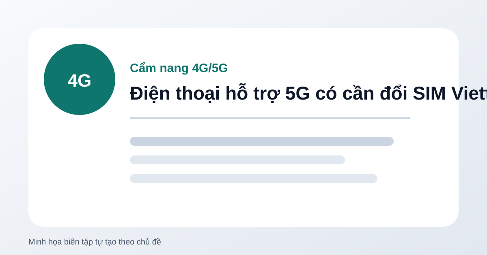

# SIM 4G Viettel có dùng được 5G không? Có cần đổi SIM 5G?

> **Trả lời nhanh:** Theo hướng dẫn chính thức của Viettel, nếu bạn đang dùng **điện thoại hỗ trợ 5G** thì có thể sử dụng mạng 5G Viettel **mà không mặc định phải đổi SIM**. Việc máy chưa hiện 5G không đủ để kết luận SIM 4G đang dùng là nguyên nhân; cần kiểm tra thêm thiết bị, cài đặt mạng, vùng phủ và trạng thái dịch vụ trên thuê bao.

**Cập nhật kiểm chứng: 04/09/2026.** Bài này chỉ khẳng định phạm vi mà Viettel công bố. Không suy diễn rằng mọi SIM cũ, mọi thiết bị 5G hoặc mọi vị trí đều chắc chắn truy cập được 5G.

## SIM 4G Viettel có phải đổi sang “SIM 5G” mới dùng được 5G không?

**Không phải mặc định.** Trong bài hướng dẫn về mạng 5G, Viettel nêu rằng khách hàng có điện thoại hỗ trợ 5G có thể sử dụng 5G **mà không cần đổi SIM**.

Nguồn first-party: [Viettel Telecom — Tốc độ của mạng 5G nhanh hơn bao nhiêu lần so với 4G?](https://www.vietteltelecom.vn/index.php/tin-tuc/chi-tiet/toc-do-mang-5g-nhanh-den-muc-do-nao/16860196), công bố ngày 03/03/2025 và được kiểm tra lại ngày 04/09/2026.

Điểm quan trọng là câu trả lời này nói về **khả năng dùng 5G mà không mặc định phải thay SIM**, chứ không phải cam kết rằng bất kỳ SIM nào đang lưu thông cũng chắc chắn đủ điều kiện trong mọi trường hợp.

## Vì sao Viettel vẫn có SIM 5G nếu SIM 4G có thể dùng 5G?

Trang thủ tục hòa mạng hiện hành của Viettel có niêm yết cả **SIM 4G** và **SIM 5G** trong cơ cấu phí SIM trắng cho thuê bao mới. Điều đó không mâu thuẫn với hướng dẫn rằng khách hàng đang có điện thoại hỗ trợ 5G có thể sử dụng 5G mà không cần đổi SIM.

Hai câu hỏi là khác nhau:

- **Hòa mạng mới chọn loại SIM nào?** Viettel hiện có quy định giá SIM trắng khác nhau theo loại SIM tại kênh hòa mạng.
- **Đang dùng SIM 4G rồi có bắt buộc đổi SIM để lên 5G không?** Viettel nêu khách hàng có điện thoại hỗ trợ 5G có thể dùng 5G mà không cần đổi SIM.

Vì vậy, không nên nhìn thấy cụm “SIM 5G” rồi suy ra mọi khách hàng 4G đều phải mua SIM mới.

## Máy hỗ trợ 5G nhưng chỉ hiện 4G: kiểm tra gì trước khi nghĩ đến đổi SIM?

Nếu điện thoại đã hỗ trợ 5G nhưng thanh trạng thái vẫn chỉ hiện 4G/LTE, hãy kiểm tra theo thứ tự này.

### 1. Xác nhận đúng thiết bị có hỗ trợ 5G

Một dòng máy có thể có nhiều phiên bản theo thị trường. Đừng chỉ dựa vào tên thương mại. Hãy kiểm tra chính xác model của máy và thông số mạng do nhà sản xuất công bố.

Nếu đang dùng iPhone, bạn có thể xem owner riêng về [cài 4G/5G và VoLTE Viettel trên iPhone](/posts/cai-dat-4g-5g-volte-iphone-viettel/).

### 2. Kiểm tra chế độ mạng 5G trên điện thoại

Máy hỗ trợ 5G nhưng đang khóa ở LTE/4G sẽ không ưu tiên kết nối 5G. Tên menu thay đổi theo hãng và phiên bản hệ điều hành, nên bài này không áp đặt một đường dẫn menu chung cho mọi Android.

Nếu mục tiêu là chẩn đoán Android và thoại VoLTE, xem [cách bật VoLTE Viettel trên Android](/posts/bat-volte-viettel-android/).

### 3. Kiểm tra vị trí và vùng phủ tại thời điểm sử dụng

Có điện thoại 5G và SIM phù hợp không đồng nghĩa mọi vị trí đều có tín hiệu 5G như nhau. Tín hiệu có thể thay đổi theo vị trí trong nhà/ngoài trời, vật cản và hạ tầng tại khu vực.

Bài này không tự công bố một bản đồ phủ sóng hoặc tỷ lệ phủ sóng tháng 09/2026 khi không có snapshot first-party đủ mới cho từng vị trí.

### 4. Kiểm tra data và trạng thái thuê bao

Biểu tượng 5G không phải là cách duy nhất để xác định vấn đề. Nếu máy có sóng nhưng không vào Internet, cần tách lỗi kết nối 5G với lỗi data/APN hoặc trạng thái gói.

Nếu có sóng 4G/5G nhưng không vào mạng, xem [cài APN Viettel và kiểm tra `v-internet`](/posts/cai-apn-viettel-4g-5g-v-internet/).

Nếu mạng vào được nhưng chậm/chập chờn, xem [cách đo tốc độ và chẩn đoán 5G Viettel](/posts/kiem-tra-toc-do-mang-my-viettel/).

### 5. Chỉ xử lý SIM khi có dấu hiệu thực sự liên quan đến SIM

Không nên đổi SIM chỉ vì một lần máy không hiện biểu tượng 5G. Nếu SIM bị lỗi, hỏng, quá cũ hoặc thuê bao có trạng thái cần hỗ trợ, hãy kiểm tra trực tiếp qua kênh Viettel trước khi thay.

Việc đổi SIM là một giao dịch khác với việc bật 5G trên điện thoại. Nếu bạn thực sự cần đổi SIM vật lý, xem owner [đổi SIM 4G Viettel trên My Viettel/cửa hàng](/posts/doi-sim-4g-viettel-tren-my-viettel/).

## Dùng eSIM Viettel thì có khác không?

Không nên hiểu eSIM là một loại mạng khác 4G/5G. eSIM là hình thức SIM tích hợp trong thiết bị; khả năng sử dụng 5G còn phụ thuộc vào thiết bị tương thích, cấu hình và điều kiện mạng.

Nếu bạn đang xử lý kích hoạt eSIM, xem [eSIM Viettel kích hoạt trên iPhone không cần quét QR trong trường hợp được hỗ trợ](/posts/esim-5g-kich-hoat-quet-qr/). Nếu cần kiểm tra thiết bị Android có hỗ trợ eSIM, xem [kiểm tra Android hỗ trợ eSIM Viettel](/posts/kiem-tra-android-co-ho-tro-esim-viettel/).

## SIM 4G dùng được 5G có đồng nghĩa dùng được 5G SA không?

Không nên gộp hai câu hỏi.

“Có thể dùng 5G mà không cần đổi SIM” là câu hỏi về **5G eligibility cơ bản**. Còn **5G SA (Standalone)** là kiến trúc mạng và khả năng tương thích sâu hơn của thiết bị/phần mềm/mạng tại thời điểm sử dụng.

Nếu bạn đang tìm hiểu riêng về Standalone, xem [5G SA Viettel là gì](/posts/5g-sa-viettel-la-gi/). Bài đó cũng giải thích vì sao không nên coi “SIM SA” là một yêu cầu mặc định chỉ dựa trên tên công nghệ.

## Có nên đi đổi SIM chỉ để “chắc chắn có 5G” không?

Không nên lấy việc đổi SIM làm bước đầu tiên nếu SIM hiện tại vẫn hoạt động bình thường.

Thứ tự hợp lý hơn là:

1. xác nhận chính xác model hỗ trợ 5G;
2. bật chế độ mạng 5G phù hợp;
3. kiểm tra vị trí/vùng phủ thực tế;
4. kiểm tra data, APN và trạng thái thuê bao;
5. nếu vẫn không được, nhờ Viettel kiểm tra trạng thái SIM/thuê bao trước khi quyết định đổi.

Cách này tránh trường hợp thay SIM nhưng nguyên nhân thực tế lại nằm ở model máy, cài đặt hoặc vị trí.

## Câu hỏi thường gặp

### SIM 4G Viettel có bắt được sóng 5G không?

Theo Viettel, khách hàng có điện thoại hỗ trợ 5G có thể sử dụng mạng 5G mà **không cần đổi SIM**. Tuy nhiên, thiết bị, cài đặt, vùng phủ và trạng thái dịch vụ vẫn cần phù hợp.

### Điện thoại 5G nhưng SIM 4G chỉ hiện LTE thì có phải SIM hỏng không?

Chưa thể kết luận. LTE có thể xuất hiện do chế độ mạng, vị trí/vùng phủ, phiên bản thiết bị hoặc điều kiện mạng. Hãy kiểm tra các yếu tố đó trước khi quy lỗi cho SIM.

### Viettel có bán SIM 5G không?

Trang thủ tục hòa mạng của Viettel hiện có niêm yết SIM 4G và SIM 5G trong cơ cấu phí SIM trắng. Điều này không đồng nghĩa khách hàng đang dùng SIM 4G bắt buộc phải đổi SIM mới dùng được 5G.

### Đổi SIM có làm 5G nhanh hơn không?

Không có đủ cơ sở để khẳng định việc đổi SIM tự nó làm tốc độ 5G nhanh hơn. Tốc độ thực tế phụ thuộc nhiều yếu tố như thiết bị, tín hiệu, tải mạng và vị trí. Hãy đo trước khi kết luận nguyên nhân.

### Có cần đăng ký một “dịch vụ 5G” riêng chỉ vì dùng SIM 4G không?

Bài này không suy diễn eligibility của từng gói hay từng thuê bao. Hãy kiểm tra gói đang dùng và trạng thái dịch vụ trên kênh Viettel tại thời điểm sử dụng. Việc SIM 4G không mặc định phải đổi không đồng nghĩa mọi gói/thuê bao có cùng điều kiện thương mại.

## Nguồn kiểm chứng

- Viettel Telecom, **“Tốc độ của mạng 5G nhanh hơn bao nhiêu lần so với 4G?”**, 03/03/2025 — nguồn xác nhận khách hàng có điện thoại hỗ trợ 5G có thể sử dụng 5G mà không cần đổi SIM.
- Viettel Telecom, **“Thủ tục hòa mạng Viettel”** — nguồn hiện hành dùng để xác nhận Viettel có niêm yết SIM 4G/SIM 5G trong cơ cấu phí SIM trắng; không dùng để suy diễn rằng khách hàng cũ bắt buộc đổi SIM.

## Kết luận

Nếu bạn đang dùng **SIM 4G Viettel** và điện thoại hỗ trợ 5G, đừng vội đổi SIM chỉ vì máy chưa hiện 5G. Viettel đã nêu rõ khách hàng có điện thoại hỗ trợ 5G có thể sử dụng 5G **không cần đổi SIM**. Hãy kiểm tra thiết bị, chế độ mạng, vị trí, data/APN và trạng thái thuê bao trước; chỉ xử lý SIM khi có bằng chứng SIM thực sự là điểm lỗi.
