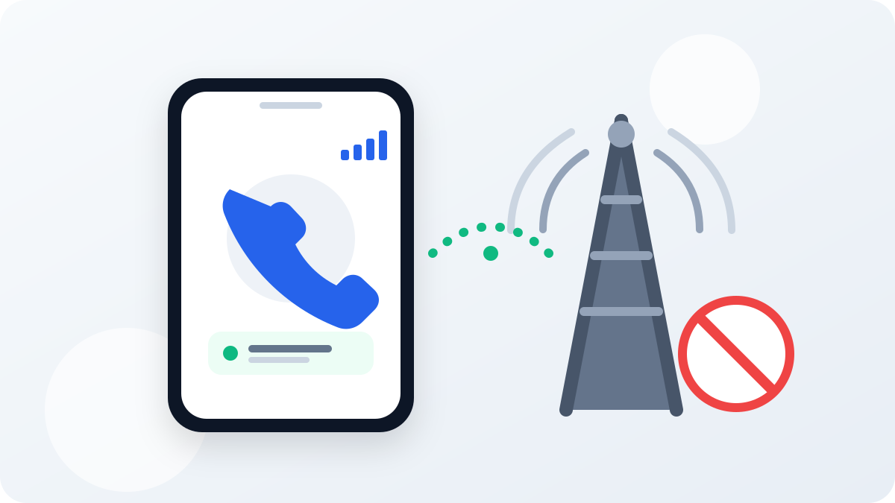

# Tắt sóng 2G 15/9/2026: còn 4 ngày, điện thoại 4G Viettel cần kiểm tra gì?

**Cập nhật kiểm chứng 11/09/2026:** chỉ còn **4 ngày** tới mốc 15/09/2026. Nguồn Bộ Khoa học và Công nghệ ngày 09/09 tiếp tục xác nhận hệ thống GSM/2G được sử dụng đến hết ngày 15/09/2026; Viettel Store ngày 07/09 cũng khuyến nghị người dùng kiểm tra khả năng VoLTE thay vì chỉ nhìn việc máy có 4G/5G hay không.

> **Trả lời nhanh:** điện thoại có 4G không tự động đồng nghĩa đã sẵn sàng cho thoại khi 2G dừng. Hãy kiểm tra theo chuỗi **máy hỗ trợ VoLTE → SIM/thuê bao dùng 4G/5G → VoLTE đã bật/được đăng ký → gọi thử thành công**. Viettel hướng dẫn đăng ký VoLTE bằng **`HDCALL` gửi `191`** và công bố **phí dịch vụ 0 đồng**.

## Tin mới 11/09/2026: còn 4 ngày, không nên chờ tới ngày cuối

Ngày 09/09/2026, Bộ Khoa học và Công nghệ công bố kết quả đấu giá băng tần 900 MHz và nhắc lại rằng hệ thống GSM được sử dụng đến hết **15/09/2026**. Bộ cho biết băng 900 MHz đang được quy hoạch lại cho 4G/5G sau khi kết thúc vai trò lịch sử của 2G.

Hai ngày trước đó, ngày 07/09/2026, Viettel Store cũng đăng nội dung về giai đoạn cuối của lộ trình tắt 2G và khuyến nghị người dùng điện thoại đời cũ hoặc máy 4G chưa rõ trạng thái thoại **kiểm tra VoLTE ngay** để tránh gián đoạn liên lạc.

Đây là freshness signal cho đúng search job mà URL này đang sở hữu, nên bài được cập nhật tại canonical hiện hữu thay vì tạo một bài “còn 4 ngày” mới gây cannibalization.

Nguồn mới:
- [Bộ Khoa học và Công nghệ — VNPT, Viettel, Vietnamobile cùng trúng đấu giá 3 cặp khối băng tần 900 MHz, 09/09/2026](https://mst.gov.vn/vnpt-viettel-vietnamobile-cung-trung-dau-gia-3-cap-khoi-bang-tan-900mhz-197260909205107936.htm)
- [Viettel Store — Cắt sóng 2G: chủ động kiểm tra thiết bị và VoLTE, 07/09/2026](https://viettelstore.vn/tin-tuc/cat-song-2g-len-doi-galaxy-a-series)

## Mốc 15/9/2026 có ý nghĩa gì?

Theo Cổng thông tin Bộ Khoa học và Công nghệ, hệ thống GSM/2G được tiếp tục sử dụng đến hết **15/09/2026**, ngoại trừ các khu vực đặc thù được nêu trong nguồn chính thức như Trường Sa, Hoàng Sa và nhà giàn DK.

Điều này khác với mốc năm 2024. Từ 16/09/2024, nhà mạng dừng phục vụ thiết bị **2G only** theo lộ trình; hạ tầng 2G vẫn tồn tại trong giai đoạn chuyển tiếp. Đến hết 15/09/2026 là mốc kết thúc hệ thống 2G theo quy hoạch tần số hiện hành.

Nguồn ngày 09/09/2026 cũng cho biết băng 900 MHz từng phục vụ 2G đang được quy hoạch lại cho 4G/5G. Bài này **không** suy diễn rằng việc đấu giá đồng nghĩa mọi nơi sẽ có tốc độ hoặc vùng phủ 4G/5G tăng ngay lập tức.

Nguồn quản lý nhà nước:
- [Bộ Khoa học và Công nghệ — Lộ trình tắt sóng 2G](https://mst.gov.vn/bo-tttt-cong-bo-lo-trinh-tat-song-2g-197240705094212138.htm)
- [Bộ Khoa học và Công nghệ — Kết quả đấu giá băng tần 900 MHz, 09/09/2026](https://mst.gov.vn/vnpt-viettel-vietnamobile-cung-trung-dau-gia-3-cap-khoi-bang-tan-900mhz-197260909205107936.htm)

## Điện thoại 4G Viettel có thể vẫn mất cuộc gọi sau khi 2G dừng không?

**Có thể.** Kết nối 4G để dùng Internet và khả năng gọi thoại trên 4G là hai việc khác nhau.

Một điện thoại có thể vẫn hiện 4G/5G và truy cập Internet bình thường nhưng cuộc gọi chưa chạy qua VoLTE. Nếu cuộc gọi còn phụ thuộc vào lớp mạng cũ, người dùng có nguy cơ gặp gián đoạn thoại khi lớp mạng đó không còn phục vụ.

Vì vậy, chỉ thử tốc độ Internet chưa đủ. Điều cần kiểm tra là **cuộc gọi có thiết lập bình thường và thiết bị có duy trì trạng thái 4G/LTE/5G/VoLTE trong lúc gọi hay không**, tùy cách từng model hiển thị.

## VoLTE là gì và Viettel bật bằng cách nào?

VoLTE là cuộc gọi thoại trên nền 4G/LTE. Viettel giải thích dịch vụ này cho phép thoại hoạt động trên hạ tầng 4G/5G thay vì phải rơi xuống lớp mạng cũ.

Theo hướng dẫn Viettel:

**`HDCALL` gửi `191`**

Viettel cũng lưu ý nhiều khách hàng có thể đã được đăng ký sẵn. Sau khi kiểm tra/bật dịch vụ, hãy thực hiện cuộc gọi thử thay vì chỉ dựa vào một biểu tượng trên màn hình.

Nguồn Viettel:
- [Viettel — VoLTE, dịch vụ thoại chất lượng cao trên hạ tầng mạng 4G/5G](https://098.viettel.vn/tin-tuc/chi-tiet/volte-dich-vu-thoai-chat-luong-cao-tren-ha-tang-mang-4g5g-viettel/13748208)

## Bật VoLTE Viettel có tốn tiền không?

**Viettel công bố phí dịch vụ VoLTE là 0 đồng.** Đây là phí dịch vụ VoLTE, không phải tuyên bố mọi cuộc gọi đều miễn phí.

Cần phân biệt:

1. **Phí dịch vụ VoLTE:** Viettel công bố **0 đồng**.
2. **Cước của cuộc gọi cụ thể:** phụ thuộc chính sách thoại/gói cước của thuê bao tại thời điểm gọi.
3. **Data của thuê bao:** nguồn Viettel được dùng ở đây không công bố một mức MB bị trừ cho từng cuộc gọi VoLTE, nên bài không tự suy diễn con số.

## Checklist 6 bước cần làm trước 15/9

### 1. Xác định máy có hỗ trợ 4G/5G và VoLTE

Không nên chỉ nhìn biểu tượng 4G. Hãy kiểm tra model có hỗ trợ VoLTE hay không và cập nhật phần mềm ổn định nếu nhà sản xuất/Viettel có hướng dẫn.

### 2. Kiểm tra đúng SIM/eSIM Viettel đang dùng cho thoại

Nếu máy dùng hai SIM, hãy xác nhận đúng SIM Viettel được chọn cho cuộc gọi. Nếu trạng thái SIM/thuê bao chưa rõ, nên xác minh với Viettel thay vì tự kết luận từ biểu tượng sóng.

### 3. Kiểm tra dịch vụ VoLTE trên thuê bao

Có thể dùng **`HDCALL` gửi `191`** theo hướng dẫn Viettel. Đây là dịch vụ thoại, không phải thao tác đăng ký gói data.

### 4. Bật VoLTE / Cuộc gọi 4G trên điện thoại nếu máy có công tắc

Tên và vị trí menu thay đổi theo hệ điều hành, model và phiên bản phần mềm.

- Android: xem [cách bật VoLTE Viettel trên Android](/posts/bat-volte-viettel-android/).
- iPhone: xem [cách bật VoLTE Viettel trên iPhone](/posts/cai-dat-4g-5g-volte-iphone-viettel/).

Hai bài trên là canonical owner cho thao tác theo nền tảng; bài hiện tại không lặp lại toàn bộ menu để tránh cannibalization.

### 5. Gọi thử thực tế

Sau khi bật VoLTE, hãy thực hiện một cuộc gọi đi. Tùy điện thoại, máy có thể tiếp tục hiển thị 4G/5G/LTE hoặc VoLTE trong khi gọi.

Nếu cuộc gọi vẫn rơi khỏi 4G/LTE hoặc không thiết lập được, hãy kiểm tra thiết bị, phần mềm, SIM và trạng thái dịch vụ với Viettel trước 15/9.

### 6. Kiểm tra USSD nếu bạn còn dùng *101#, *102#, *098# hoặc nạp thẻ bằng mã bấm

Viettel ngày 03/07/2026 khuyến nghị cập nhật phần mềm hoặc thiết bị có hỗ trợ **USSD qua 4G/IMS**. Nếu USSD không hoạt động, Viettel nêu các kênh thay thế như My Viettel/Tammi, SMS hoặc tổng đài 198.

Nếu vấn đề của bạn là USSD, xem canonical riêng [USSD Viettel qua 4G/VoLTE/IMS](/posts/ussd-viettel-qua-4g-volte-ims/).

Nguồn Viettel:
- [Viettel — Cập nhật phần mềm và thiết bị hỗ trợ USSD khi tắt 2G, 03/07/2026](https://shop.viettel.vn/tin-tuc/chi-tiet/cap-nhat-phan-mem-va-thiet-bi-ho-tro-ussd-khong-lo-gian-doan-dich-vu-khi-tat-song-2g/14894320)

## Máy hiện 4G/5G nhưng gọi không được: xử lý theo thứ tự nào?

Hãy xử lý từ ít rủi ro đến nhiều thay đổi hơn:

1. kiểm tra đúng SIM Viettel trên máy hai SIM;
2. kiểm tra loại mạng ưu tiên có 4G/LTE hoặc 5G;
3. xác minh thiết bị có VoLTE;
4. xác minh dịch vụ VoLTE trên thuê bao;
5. bật VoLTE nếu máy có công tắc;
6. khởi động lại máy sau thay đổi cấu hình;
7. gọi thử lại;
8. nếu vẫn lỗi, liên hệ Viettel để kiểm tra theo thuê bao và model cụ thể.

Không nên xóa eSIM, reset toàn bộ máy hoặc nhập mã kỹ thuật không có trong hướng dẫn chính thức chỉ để thử sửa lỗi thoại.

## Có phải đổi SIM chỉ vì sắp tắt 2G?

**Không nên mặc định.** Nếu SIM/eSIM Viettel hiện tại đã hỗ trợ 4G/5G và thuê bao hoạt động bình thường, vấn đề cần kiểm tra tiếp là thiết bị và VoLTE.

Nếu câu hỏi của bạn là SIM 4G hiện tại có dùng được 5G hay bắt buộc đổi SIM, xem canonical riêng [SIM 4G Viettel có dùng được 5G không?](/posts/sim-4g-viettel-co-dung-duoc-5g-khong/).

## Có phải đổi điện thoại nếu máy đang có 4G?

Không phải mọi máy 4G đều cần đổi. Trước tiên hãy xác định **máy có hỗ trợ VoLTE phù hợp hay không**.

Nếu model hỗ trợ VoLTE và cuộc gọi thử hoạt động trên 4G/LTE, không có cơ sở để kết luận chỉ vì tắt 2G mà bắt buộc phải thay máy. Ngược lại, nếu thiết bị chỉ dùng 4G cho data nhưng không có khả năng thoại VoLTE, cần cân nhắc thiết bị phù hợp hơn để tránh gián đoạn cuộc gọi.

## Những điều bài này không khẳng định

Để tránh suy diễn từ nguồn, các điểm sau giữ trạng thái **UNKNOWN/không xác minh phổ quát**:

- mọi model 4G đều hỗ trợ VoLTE;
- mọi nơi sẽ tắt 2G vào cùng một giờ chính xác;
- mọi thuê bao có cùng trình tự xử lý;
- mọi SMS/OTP sẽ có hành vi giống nhau trên mọi thiết bị sau khi 2G dừng;
- mọi SIM cũ đều phải đổi;
- mọi cuộc gọi VoLTE đều miễn phí;
- một cuộc gọi VoLTE cụ thể sẽ trừ bao nhiêu MB data;
- mọi lỗi thoại đều do 2G shutdown;
- mọi khu vực sẽ ngay lập tức có cùng chất lượng 4G/5G sau khi băng tần được tái quy hoạch.

## Câu hỏi nhanh

### Tắt 2G rồi điện thoại 4G Viettel có còn dùng Internet không?
Nếu thiết bị, SIM và vùng phủ 4G/5G đáp ứng, data có thể vẫn hoạt động. Rủi ro được nói đến trong bài này là **thoại** trên một số máy 4G chưa sẵn sàng VoLTE.

### Có 4G nhưng gọi điện bị mất mạng sau khi 2G dừng thì kiểm tra gì trước?
Kiểm tra VoLTE của thiết bị và thuê bao, đúng SIM, loại mạng 4G/5G rồi gọi thử lại. Android và iPhone có hướng dẫn riêng trên website.

### Viettel bật VoLTE bằng cú pháp nào?
Theo tài liệu Viettel: **`HDCALL` gửi `191`**.

### Đăng ký VoLTE Viettel có mất phí không?
Theo tài liệu Viettel được kiểm tra lại, **phí dịch vụ VoLTE là 0 đồng**. Điều đó không đồng nghĩa mọi cuộc gọi của thuê bao đều có cước 0 đồng.

### Vì sao ngày 11/09 chủ đề này cần cập nhật?
Vì canonical cũ vẫn hiển thị freshness “còn 11 ngày” từ 04/09, trong khi ngày 11/09 chỉ còn 4 ngày tới mốc 15/09. Bộ Khoa học và Công nghệ ngày 09/09 và Viettel Store ngày 07/09 đều tiếp tục xác nhận tính cấp thời của việc chuyển khỏi 2G và kiểm tra VoLTE.

## Nguồn kiểm chứng

- [Bộ Khoa học và Công nghệ — Lộ trình tắt sóng 2G](https://mst.gov.vn/bo-tttt-cong-bo-lo-trinh-tat-song-2g-197240705094212138.htm)
- [Bộ Khoa học và Công nghệ — Kết quả đấu giá băng tần 900 MHz, 09/09/2026](https://mst.gov.vn/vnpt-viettel-vietnamobile-cung-trung-dau-gia-3-cap-khoi-bang-tan-900mhz-197260909205107936.htm)
- [Viettel Store — Cắt sóng 2G, chủ động kiểm tra thiết bị và VoLTE, 07/09/2026](https://viettelstore.vn/tin-tuc/cat-song-2g-len-doi-galaxy-a-series)
- [Viettel — VoLTE trên hạ tầng 4G/5G](https://098.viettel.vn/tin-tuc/chi-tiet/volte-dich-vu-thoai-chat-luong-cao-tren-ha-tang-mang-4g5g-viettel/13748208)
- [Viettel — USSD qua 4G/IMS khi tắt 2G, 03/07/2026](https://shop.viettel.vn/tin-tuc/chi-tiet/cap-nhat-phan-mem-va-thiet-bi-ho-tro-ussd-khong-lo-gian-doan-dich-vu-khi-tat-song-2g/14894320)

**Cập nhật nguồn:** 11/09/2026. Giá gói cước, vùng phủ theo địa chỉ, model tương thích phổ quát và các chỉ số search volume/KD/CPC/ranking/traffic potential không được suy diễn trong bài này.