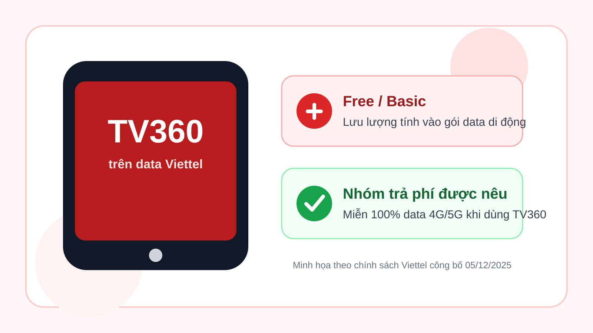

# TV360 giảm 30% giá gói đến 31/12/2026: gói nào được ưu đãi?

> **Cập nhật 22/09/2026:** Viettel Telecom công bố chương trình giảm **30%** cho bốn gói TV360 chu kỳ 30 ngày gồm **Standard, VIP Mobile, VSport và VCine**. Chương trình áp dụng từ **11/09 đến hết 31/12/2026** theo điều kiện thanh toán được Viettel nêu trong thông báo chính thức.

## Giá TV360 sau khi giảm 30%

Theo thông báo Viettel ngày 22/09/2026, mức giá ưu đãi cho chu kỳ 30 ngày được công bố như sau:

| Gói TV360 | Giá ưu đãi được Viettel công bố |
| --- | ---: |
| **VCine** | từ **21.000đ** |
| **VSport** | từ **24.500đ** |
| **VIP Mobile** | từ **28.000đ** |
| **Standard** | từ **42.000đ** |

Các mức trên là **giá trong chương trình ưu đãi**, không nên hiểu là giá cố định vĩnh viễn của dịch vụ.

## Ai được áp dụng ưu đãi?

Viettel nêu chương trình áp dụng khi thanh toán qua một trong các phương thức sau:

- tài khoản gốc di động Viettel;
- Viettel Money;
- MoMo;
- ZaloPay;
- VNPAY;
- ShopeePay.

Có hai điều kiện quan trọng cần đọc trước khi thanh toán:

1. **Giá khuyến mại chỉ áp dụng cho chu kỳ thanh toán đầu tiên.**
2. Chương trình **không áp dụng với thuê bao đăng ký từ tư vấn viên của các kênh bán tại tỉnh/thành phố** theo thông báo Viettel.

Nếu ứng dụng TV360 hiển thị giá hoặc điều kiện khác cho tài khoản của bạn, nên ưu tiên thông tin đang được hệ thống chính thức hiển thị tại thời điểm giao dịch.

## Xem TV360 bằng 4G/5G Viettel có bị trừ data không?

Trong chính thông báo ưu đãi ngày 22/09/2026, Viettel cho biết người dùng các gói trong chương trình được **miễn phí data 4G/5G Viettel khi xem trên ứng dụng TV360**.

Điều này cần được phân biệt với **TV360 Free/Basic**. Chính sách data TV360 trước đó của Viettel quy định Free/Basic có thể tính lưu lượng vào gói data di động đang sử dụng, trong khi các nhóm TV360 trả phí được Viettel liệt kê có chính sách miễn lưu lượng riêng.

Nếu mục tiêu của bạn là kiểm tra chính xác trường hợp Free, Basic và trả phí, xem bài [TV360 Viettel có tốn data 4G/5G không?](/posts/tv360-viettel-co-ton-data-4g-5g-khong/).

## Nên chọn VCine, VSport, VIP Mobile hay Standard?

Không nên chọn chỉ vì mức giá thấp nhất. Hãy bắt đầu từ nhu cầu nội dung và thiết bị sử dụng:

- **VCine:** phù hợp khi ưu tiên nhóm nội dung phim theo phạm vi quyền lợi mà TV360 đang công bố cho gói.
- **VSport:** nên kiểm tra nếu mục tiêu chính là nội dung thể thao.
- **VIP Mobile:** phù hợp với người xem chủ yếu trên thiết bị di động nếu quyền lợi hiện hành đáp ứng nhu cầu.
- **Standard:** nên kiểm tra khi cần phạm vi sử dụng/nội dung rộng hơn các lựa chọn giá thấp hơn.

Bài này không tự suy diễn số thiết bị, danh sách kênh hay toàn bộ kho nội dung của từng gói ngoài thông báo chính thức ngày 22/09/2026. Các quyền lợi đó có thể thay đổi và cần được kiểm tra trên TV360 trước khi mua.

## Cách tránh nhầm giá sau tháng đầu

Vì mức giảm 30% chỉ áp dụng cho **chu kỳ thanh toán đầu tiên**, trước khi xác nhận nên kiểm tra ba thông tin trên màn hình thanh toán:

1. giá phải trả ở chu kỳ hiện tại;
2. trạng thái gia hạn của gói;
3. mức giá/điều kiện được hiển thị cho chu kỳ tiếp theo.

Nếu chưa rõ, không nên suy từ giá ưu đãi tháng đầu thành chi phí cố định cho các tháng sau.

## Câu hỏi thường gặp

### TV360 giảm 30% đến ngày nào?

Theo Viettel Telecom, chương trình diễn ra từ **11/09/2026 đến hết 31/12/2026**.

### Những gói nào được giảm 30%?

Thông báo ngày 22/09/2026 nêu bốn gói chu kỳ 30 ngày: **Standard, VIP Mobile, VSport và VCine**.

### Giá 21.000đ của VCine có áp dụng mọi tháng không?

Không nên hiểu như vậy. Viettel lưu ý **giá khuyến mại chỉ áp dụng cho chu kỳ thanh toán đầu tiên**.

### Thanh toán bằng tài khoản gốc Viettel có được giảm không?

Có trong phạm vi chương trình được Viettel công bố; ngoài tài khoản gốc di động Viettel còn có Viettel Money, MoMo, ZaloPay, VNPAY và ShopeePay.

### Gói ưu đãi có miễn data 4G/5G Viettel không?

Thông báo Viettel ngày 22/09/2026 nêu người dùng được **miễn phí data 4G/5G Viettel khi xem trên ứng dụng TV360**. Không nên mở rộng quyền lợi này sang mọi loại TV360 hoặc mọi cách truy cập ngoài phạm vi Viettel công bố.

## Nguồn kiểm chứng

- [Viettel Telecom — TV360 giảm 30% giá gói cước, tận hưởng giải trí chỉ từ 21.000 đồng/tháng](https://www.vietteltelecom.vn/tin-tuc/chi-tiet/tv360-giam-30-gia-goi-cuoc-tan-huong-giai-tri-chi-tu-21000-dongthang/15965268), công bố **22/09/2026**.
- [Viettel Telecom — Cập nhật chính sách miễn phí lưu lượng data khi truy cập TV360 trên mạng di động Viettel](https://www.vietteltelecom.vn/index.php/tin-tuc/chi-tiet/cap-nhat-chinh-sach-mien-phi-luu-luong-data-khi-truy-cap-tv360-tren-mang-di-dong-viettel/10261324), công bố **05/12/2025**.

**Phạm vi kiểm chứng:** giá ưu đãi, thời gian, phương thức thanh toán, giới hạn chu kỳ đầu và quyền miễn data trong chương trình được lấy từ nguồn first-party Viettel. Search volume, KD, CPC, ranking và traffic potential không có dữ liệu xác minh trong lượt này và được giữ ở trạng thái `UNKNOWN`.