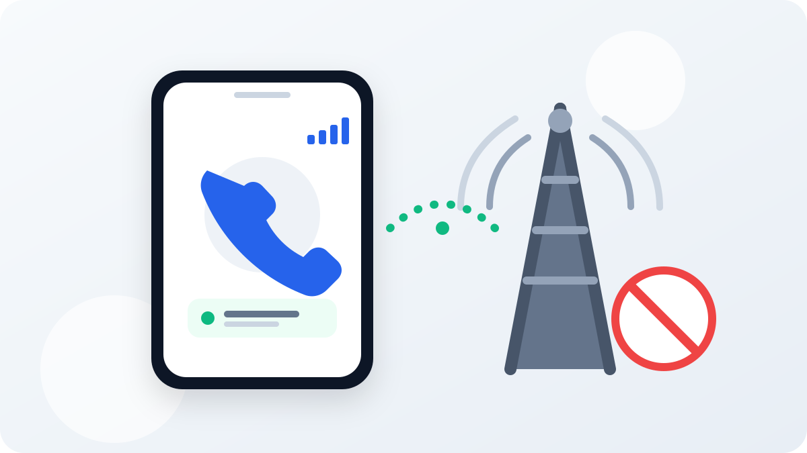

# Viettel trúng đấu giá băng tần 900 MHz: liên quan gì tới 4G/5G sau khi tắt 2G?

**Cập nhật 10/09/2026:** Bộ Khoa học và Công nghệ công bố tối 09/09/2026 rằng **Viettel trúng đấu giá cặp khối băng tần C4-C4'**, gồm **905-910 MHz và 950-955 MHz**, với mức giá gần **1.077 tỷ đồng**. Băng tần 900 MHz vốn gắn với hạ tầng 2G đang được quy hoạch lại cho **4G và các công nghệ tiếp theo** sau mốc chuyển đổi.

> **Trả lời nhanh:** kết quả đấu giá là tin quan trọng về **tài nguyên tần số và hạ tầng mạng**, nhưng không có nghĩa điện thoại của bạn tự nhiên nhanh hơn ngay trong ngày 10/09. Với người dùng Viettel, việc cần làm trước mốc **15/09/2026** vẫn là kiểm tra thiết bị 4G/5G, SIM phù hợp và **VoLTE** nếu cần gọi thoại trên mạng mới.

## Viettel vừa trúng khối băng tần nào?

Theo Cổng thông tin điện tử Bộ Khoa học và Công nghệ, phiên đấu giá chiều **09/09/2026** chia băng tần 900 MHz thành ba cặp khối. Kết quả:

- VNPT trúng C3-C3'.
- **Viettel trúng C4-C4': 905-910 MHz và 950-955 MHz.**
- Vietnamobile trúng C5-C5'.

Mức trúng của Viettel được cơ quan quản lý công bố là **gần 1.077 tỷ đồng**. Bài này dùng con số đó đúng theo nguồn quản lý nhà nước, không tự quy đổi thành chi phí đầu tư mạng hay dự báo doanh thu.

Nguồn chính thức: [Bộ Khoa học và Công nghệ — VNPT, Viettel, Vietnamobile cùng trúng đấu giá 3 cặp khối băng tần 900MHz, 09/09/2026](https://mst.gov.vn/vnpt-viettel-vietnamobile-cung-trung-dau-gia-3-cap-khoi-bang-tan-900mhz-197260909205107936.htm).

## Vì sao 900 MHz lại liên quan tới mốc tắt 2G?

900 MHz là một trong các dải tần đã được sử dụng từ sớm cho mạng GSM/2G. Bộ Khoa học và Công nghệ cho biết hệ thống GSM theo lộ trình được sử dụng đến hết **15/09/2026**; việc dừng 2G cho phép doanh nghiệp tối ưu hạ tầng và sử dụng lại tài nguyên tần số cho công nghệ mới hơn.

Trong chính thông tin đấu giá ngày 09/09, cơ quan quản lý nêu băng tần 900 MHz được **quy hoạch lại cho 4G/5G**. Các doanh nghiệp trúng đấu giá sẽ sử dụng băng tần này để cung cấp **4G và các công nghệ tiếp theo**; giấy phép sử dụng có thời hạn **15 năm kể từ khi có hiệu lực**.

Điểm cần phân biệt là: **mốc tắt 2G và ngày mạng 4G/5G sử dụng từng khối tần số cụ thể không phải cùng một khái niệm**. Nguồn công bố không nói rằng toàn bộ vùng phủ, tốc độ hay cấu hình mạng Viettel sẽ thay đổi đồng loạt vào một giờ cố định ngay sau 15/09.

## Trúng 900 MHz có nghĩa Viettel 4G/5G sẽ mạnh hơn ngay không?

Không nên kết luận như vậy chỉ từ kết quả đấu giá.

Băng tần thấp như 900 MHz có giá trị cho quy hoạch mạng và cơ quan quản lý cho biết việc sở hữu dải tần này tạo cơ hội mở rộng vùng phủ và triển khai 4G/5G hiệu quả hơn. Tuy nhiên, trải nghiệm thực tế của một thuê bao còn phụ thuộc nhiều yếu tố như vị trí, thiết bị, cấu hình mạng, tải trạm, SIM và lộ trình triển khai của nhà mạng.

Vì vậy bài này **không đưa ra** các tuyên bố kiểu “từ ngày 16/09 sóng Viettel sẽ mạnh hơn X%”, “5G sẽ phủ toàn bộ một địa phương” hay “tốc độ chắc chắn tăng lên một mức cụ thể”. Những claim đó cần dữ liệu triển khai và đo kiểm riêng.

## Người đang dùng Viettel có phải đổi SIM vì cuộc đấu giá này không?

**Không.** Việc Viettel trúng băng tần 900 MHz tự nó không phải là lý do để đổi SIM.

Viettel hướng dẫn rằng sau giai đoạn chuyển đổi 2G, để tiếp tục sử dụng hạ tầng 4G/5G, người dùng cần thiết bị và SIM phù hợp; với thoại, thiết bị 4G/5G cần hỗ trợ VoLTE và dịch vụ VoLTE phải hoạt động. Nếu SIM hiện tại của bạn đã là SIM 4G/5G và thiết bị hoạt động bình thường, không nên đổi SIM chỉ vì đọc tin đấu giá băng tần.

Nếu bạn đang cần kiểm tra riêng vấn đề này, xem [SIM 4G Viettel có dùng được 5G không?](/posts/sim-4g-viettel-co-dung-duoc-5g-khong/).

## Điều cần kiểm tra trước 15/09/2026

Với người dùng di động, tin đấu giá quan trọng về mặt hạ tầng nhưng checklist thực tế vẫn rất đơn giản:

1. **Kiểm tra máy hỗ trợ 4G/5G.** Không nên chỉ dựa vào tên thương mại của thiết bị.
2. **Kiểm tra VoLTE nếu bạn cần gọi thoại.** Viettel hướng dẫn dịch vụ VoLTE trên nhiều dòng máy và cho phép đăng ký bằng `HDCALL` gửi `191`; phí dịch vụ VoLTE được Viettel công bố là 0 đồng.
3. **Gọi thử thực tế.** Một máy có data 4G không đồng nghĩa cuộc gọi chắc chắn đang chạy qua VoLTE.
4. **Cập nhật phần mềm nếu USSD gặp vấn đề.** Viettel đã khuyến nghị thiết bị hỗ trợ USSD qua 4G/IMS để tránh gián đoạn khi lớp mạng cũ dừng.

Xem hướng dẫn chi tiết tại [Tắt sóng 2G 15/9/2026: điện thoại 4G Viettel có bị mất cuộc gọi không?](/posts/tat-song-2g-15-9-2026-viettel-volte/). Đây là canonical owner cho câu hỏi hỗ trợ người dùng về mốc dừng 2G; bài hiện tại chỉ sở hữu intent **tin tức + giải thích băng tần 900 MHz**.

## Android và iPhone kiểm tra VoLTE ở đâu?

Vị trí menu khác nhau theo hãng, model và phiên bản phần mềm. Không nên dùng một đường dẫn cài đặt cho mọi máy.

- Android: [Cách bật VoLTE Viettel trên Android](/posts/bat-volte-viettel-android/).
- iPhone: [Cài đặt 4G/5G/VoLTE Viettel trên iPhone](/posts/cai-dat-4g-5g-volte-iphone-viettel/).

Viettel hiện có hướng dẫn VoLTE cho iPhone, Samsung, Huawei, Oppo/Realme, Redmi/Xiaomi, Nokia, Vivo, Poco, Google Pixel, Sony Xperia và một số nhóm thiết bị khác. Khả năng tương thích cuối cùng vẫn cần kiểm tra theo model và phần mềm thực tế.

## USSD như *098# có bị ảnh hưởng khi 2G dừng không?

Đây là một search job khác với đấu giá băng tần, nhưng có liên quan tới giai đoạn chuyển đổi. Viettel ngày **03/07/2026** khuyến nghị người dùng cập nhật phần mềm hoặc thiết bị hỗ trợ **USSD over IMS/4G**, vì các lệnh USSD truyền thống vốn phụ thuộc nhiều vào lớp mạng cũ.

Nếu vấn đề của bạn là `*098#`, `*101#`, `*102#` hoặc mã USSD không phản hồi, xem [USSD Viettel qua 4G/VoLTE/IMS](/posts/ussd-viettel-qua-4g-volte-ims/).

## C4-C4' có phải là một “gói 5G” mới không?

**Không.** C4-C4' là tên cặp khối tần số trong phiên đấu giá, không phải mã gói cước bán cho thuê bao. Người dùng không cần đăng ký “C4” hay thay đổi gói data để “dùng băng tần C4”.

Gói cước, eligibility và quyền lợi data là lớp thương mại riêng. Bài này không suy diễn bất kỳ giá gói, ưu đãi, vùng phủ hay điều kiện thuê bao nào từ kết quả đấu giá.

## Kết luận

Tin mới ngày 09/09/2026 xác nhận **Viettel đã trúng cặp khối 900 MHz C4-C4' (905-910/950-955 MHz)**. Đây là một phần của quá trình tái quy hoạch tài nguyên sau thời kỳ 2G và tạo nền tảng cho 4G/các công nghệ tiếp theo. Với người dùng, điều quan trọng trước **15/09/2026** vẫn là thiết bị, SIM và VoLTE — chứ không phải tự đổi SIM hoặc kỳ vọng tốc độ thay đổi ngay vì một phiên đấu giá.

### Nguồn kiểm chứng

- [Bộ Khoa học và Công nghệ — Kết quả đấu giá 3 cặp khối băng tần 900 MHz, 09/09/2026](https://mst.gov.vn/vnpt-viettel-vietnamobile-cung-trung-dau-gia-3-cap-khoi-bang-tan-900mhz-197260909205107936.htm)
- [Viettel — Thông báo lộ trình sử dụng hạ tầng GSM đến 15/09/2026](https://shop.viettel.vn/tin-tuc/chi-tiet/thong-bao-dieu-chinh-thoi-gian-dung-dich-vu-cho-thiet-bi-2g-only-theo-quy-dinh-cua-bo-thong-tin-truyen-thong/13691148)
- [Viettel — Hướng dẫn bật VoLTE, 14/04/2026](https://098.viettel.vn/tin-tuc/huong-dan-bat-dich-vu-cuoc-goi-volte-goi-chat-luong-tot-hon-an-toan-hon/15298552)
- [Viettel — USSD over IMS trước khi tắt 2G, 03/07/2026](https://098.viettel.vn/tin-tuc/chi-tiet/cap-nhat-phan-mem-va-thiet-bi-ho-tro-ussd-khong-lo-gian-doan-dich-vu-khi-tat-song-2g/14894320)
